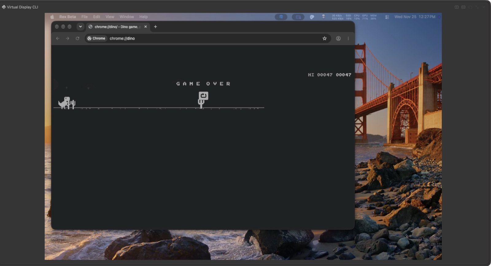

# virtual display CLI [concept]

`vd` controls native Mac app windows on a 1440 × 900 extended display in the current login. Run `vd help` for commands and argument order. The host starts without opening an editor or preview window.



From a Rex or other Kitty-graphics terminal, run `vd` to watch the running workspace full-screen. `vd view --list` lists available virtual displays and `vd view ID` selects one. On the VD workspace, `-` increases the virtual monitor resolution, `+` decreases it, and `0` restores 1440×900. The picture stays fitted to the terminal. Tab switches between them, and q or Escape returns to the shell. Capture is read-only and uses the signed app's Screen Recording grant. ScreenCaptureKit sends changed frames at up to eight frames per second.

In Codex, ask “Use the vd CLI to open this PDF in Preview on the virtual display.” The registered `virtual-display` MCP server provides action, observation, and PNG viewing tools. Codex applies the session’s normal tool approval settings. A terminal can call `~/.local/bin/vd` directly.

```sh
vd start
vd launch Preview "$HOME/Documents/example.pdf"
vd windows --all
vd move PID WINDOW
vd inspect PID WINDOW
vd screenshot PID WINDOW /tmp/vd-window.png
```

`vd authorize` requests Accessibility and Screen Recording for **Virtual Display.app**. The host posts input to a target PID and checks window membership. Keyboard input requires a separate background process with a single visible window. Applications control whether they accept new instances, background events, and Accessibility actions. Read back state or pixels to confirm results.

Run `./install.sh` to rebuild and install. On first use it creates **VD Local Code Signing** in the user's login Keychain. Subsequent builds pin the same certificate and bundle identifier in their designated requirement. This identity is for this Mac. Run `python3 test_live.py -v` to exercise the background fixture, TextEdit and Preview. Tests use temporary documents.

For reliable browser input launch a dedicated Chrome page, e.g. `vd launch Chrome chrome://dino`, then `vd key PID WINDOW Space`. Dedicated Chrome uses a temporary profile and a private debugging pipe and accepts text through `vd type`. It is separate from your signed-in Chrome profile.
